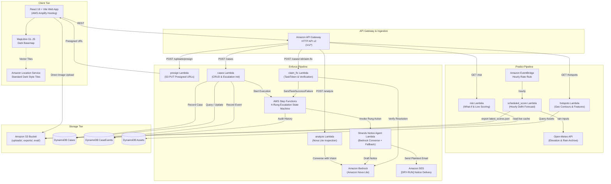

# Argus

> **Waterlogging prediction + hazard accountability platform for Delhi streets**

Argus predicts where Delhi streets will waterlog under adjustable rain conditions, highlights hidden road hazards (open manholes, potholes, missing drain covers) lurking underwater, resolves municipal ownership and contractor warranty defect liability, and runs an automated civic escalation workflow until verified fixed.

---

## 1. Honesty Banner & Transparency

> **Risk is a relative ranking from an expert-prior model, not a flood-depth forecast. Data tagged 'illustrative' is placeholder and must be verified.**

- **Strict Dry-Run Isolation:** All complaint notices generated during demo runs start with `[DRY-RUN]` and are delivered solely to a designated sandbox email inbox (`DRYRUN_INBOX`).
- **Safety First:** No real government official email addresses or phone numbers are contacted or stored. Recipients are illustrative administrative roles (e.g., *"Executive Engineer, PWD Division (illustrative)"*).
- **No Invented Entities:** All contractors use demo designations (e.g., *"Contractor A (demo)"*).
- **Explicit Provenance:** Every record features an explicit `provenance` tag (`sourced` with source URLs, `illustrative`, or `simulated`), reflected dynamically in UI chips.
- **Empirical Honesty:** Evaluation results render *"Not yet measured"* or *"No backtest events loaded"* when raw data is not supplied, never fabricating metrics.

---

## 2. System Architecture



---

## 3. How AWS Services Are Used

1. **Amazon Bedrock (Amazon Nova Lite):**
   - **Hazard Triage:** Visual inspection of citizen street photos using forced tool calling (`report_hazard`) to extract hazard type, severity (1-5), submerged state, confidence, and visual evidence.
   - **Verification Auditor:** Compares before/after repair photos for claimed fixes using `report_verification`.
   - **Contract Analysis:** Verbatim extraction of maintenance / defect-liability clauses from tender PDFs via Converse document blocks.
   - **Where it appears in demo:** In Shot 3 ("Report Hazard" photo inspection card), Shot 4 (quoted maintenance clause badge), and Shot 7 ("Claim Fix" before/after repair verification).

2. **AWS Step Functions:**
   - 4-Rung escalation state machine (`statemachine/escalation.asl.json`) governing administrative progression from local engineer up to District Magistrate task forces.
   - Uses `waitForTaskToken` callback pattern so citizen repair claims can pause, verify, and resolve or escalate the workflow.
   - **Where it appears in demo:** In Shot 6 ("Cases Workflow" modal 4-rung visual ladder with live timer countdowns and audit log).

3. **Amazon DynamoDB:**
   - On-demand serverless tables: `Assets` (ground hazards), `Cases` (workflow state & tokens), and `CaseEvents` (immutable audit timeline).
   - **Where it appears in demo:** Map hazard markers (Assets), Cases drawer (Cases & CaseEvents), and Blame-chain resolution.

4. **Amazon Simple Email Service (SES):**
   - Formatted dry-run notification delivery with automated disclaimer header and OpenStreetMap geotag links.
   - **Where it appears in demo:** In Shot 5 (Notice preview drawer with `[DRY-RUN]` header, OSM coordinate link, and dry-run delivery note).

5. **Amazon S3:**
   - Direct-to-bucket presigned PUT uploads (`uploads/`), tender documents (`tenders/`), hourly score batch exports (`exports/`), and evaluation metrics (`eval/`).
   - **Where it appears in demo:** In Shot 3 (direct browser photo upload via presigned URL) and Evidence modal data fetch.

6. **Amazon EventBridge:**
   - Scheduled hourly rule triggering `scheduled_score` to fetch live Delhi rainfall forecasts and precalculate susceptibility matrices.
   - **Where it appears in demo:** In Sidebar "Live (hourly)" mode toggle and Shot 9 Architecture diagram.

7. **Amazon API Gateway HTTP API v2:**
   - Low-latency CORS-enabled REST API (`/v1/*`) with rate throttling (20 req/s, 40 burst).
   - **Where it appears in demo:** Seamless client-side data queries and mutations across all map interactions.

8. **AWS Lambda:**
   - Python 3.12 serverless microservices sharing common layer dependencies (`common/`, `civic_data/`).
   - **Where it appears in demo:** Powers all risk calculations, notice generation, and case progression.

9. **Amazon Location Service:**
   - Vector basemap tiles using the standard dark color scheme style.
   - **Where it appears in demo:** In Shot 1 & 2 (the interactive vector street map of Delhi and hotspot markers).

10. **AWS Amplify Hosting:**
    - Static single-page application hosting with instant global CDN distribution.
    - **Where it appears in demo:** The browser URL bar hosting the live Argus dashboard.

---

## 4. Local Development & Testing

### Prerequisites
- Python 3.12+
- Node.js 20+ & npm
- AWS CLI v2 & AWS SAM CLI

### Running Backend Tests
```bash
# Run the complete backend and local integration suite
uv run pytest tests -v
```

### Running Frontend Locally
```bash
cd frontend
# Install dependencies
npm install

# Run unit tests
npm run test

# Run typecheck and production build
npm run build

# Start local development server with mock mode enabled
VITE_USE_MOCKS=true npm run dev
```

Local frontend mocks are read-only and visibly labeled; uploads, report/case workflows, and live inference require a backend. Production rejects mock mode. Backend inference fixtures require `USE_MOCKS=true ARGUS_ENV=local` and separate test doubles for storage/persistence/email.

`npm run test:api` provides dependency-free API checks on Node 22.6+ (24 used here); it does not replace TypeScript, Vitest, or browser validation.

Visit `http://localhost:5173/?demo=1` to explore the app with seeded demo data and active keyboard shortcuts (`1` Light, `2` Heavy, `3` Extreme, `0` Clear, `h` Hazard-under-water).

---

## 5. Deployment Guide

Deployment is automated via AWS SAM. Read [deployment readiness](docs/DEPLOYMENT_READINESS.md) and `docs/HUMAN_TODO.md` first. Obtain explicit approval before deployment, test writes, or billable inference.

```bash
# 1. Configure AWS credentials (ap-southeast-2, profile hackathon)
aws configure --profile hackathon

# 2. Only after validation, verified identities, and deployment approval
EXPECTED_AWS_ACCOUNT_ID="<verified-project-id>" \
SES_FROM="<verified-sender>" DRYRUN_INBOX="<verified-inbox>" ./scripts/deploy.sh

# 3. Seed demo data into DynamoDB only after test-write approval
python scripts/seed_demo.py --profile hackathon --region ap-southeast-2

# 4. Run smoke test only after approving its writes/inference scope
./scripts/smoke_test.sh "https://<api-id>.execute-api.ap-southeast-2.amazonaws.com/v1"
```

---

## 6. Datasets & Credits

- **Open-Meteo:** Weather Forecast API, Archive API, and Elevation API under [CC BY 4.0](https://creativecommons.org/licenses/by/4.0/).
- **OpenStreetMap:** Map data © [OpenStreetMap contributors](https://www.openstreetmap.org/copyright) under ODbL 1.0.
- **RDD2022 India Subset:** Road Damage Dataset 2022 under [CC BY-SA 4.0](https://creativecommons.org/licenses/by/4.0/).
- **MapLibre GL JS:** Open-source vector map client under BSD 3-Clause.
- Full details in [CREDITS.md](CREDITS.md).

---

## 7. AI Tools Used

- **Google Antigravity:** AI-assisted agentic software engineering throughout system planning, coding, and verification.
- **Amazon Bedrock (Amazon Nova Lite):** Foundation model inference for vision inspection, verification, and contract extraction.
- Details in [AI_TOOLS.md](AI_TOOLS.md).

---

## 8. Limitations & Future Work

- **Elevation Proxy Coarseness:** Elevation contours are sampled from a ~90m surface model that includes building heights; local depressions should be treated as coarse hydrological proxies rather than hydrodynamic flow models.
- **Expert Priors:** The logistic susceptibility parameters represent calibrated heuristic priors; coefficients have not been fitted to dense historical flood gauge telemetry.
- **Deterministic Jurisdiction:** Road ownership attribution rules are heuristics based on road width and class; disputed boundaries require on-the-ground survey confirmation.
- **Prototype Dry-Run:** All escalation emails are routed to a verified dry-run inbox to prevent accidental contact with civic authorities during demonstrations.
