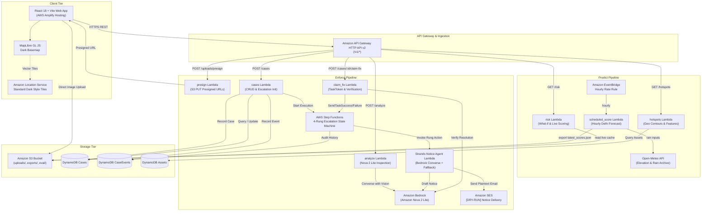

# Architecture & System Design — Argus

Argus implements an automated dual-pipeline architecture:
1. **Predict:** Risk assessment & hydrological susceptibility modeling for Delhi arterial roads.
2. **Enforce:** AI hazard inspection, deterministic blame chain attribution, and 4-rung Step Functions escalation.

---

## 1. System Architecture Diagram

---

## 2. Key Subsystems

### 2.1 Predict Pipeline
- **Susceptibility Scoring:** Computes local topographic depression, relative elevation, underpass indicator, and historic rainfall susceptibility using calibrated logistic transforms.
- **Hourly Live Batch:** `scheduled_score` runs via EventBridge every hour, pulls Delhi rainfall from Open-Meteo, evaluates all hotspots, and stores `latest_scores.json` in S3.
- **Real-Time Simulation:** In What-if mode, the browser dynamically computes response matrices with immediate debounce feedback.

### 2.2 Enforce Pipeline
- **Image Triage & Hazard Extraction:** Photos uploaded directly to S3 via presigned PUTs are analyzed by Amazon Nova 2 Lite using forced tool-calling schemas.
- **Blame Chain & Warranty Tracking:** Deterministically resolves road ownership across NHAI, NDMC, PWD, DJB, and MCD based on road width, highway status, and asset type. Matches maintenance contracts to determine active defect-liability windows.
- **4-Rung Escalation Flow:** An AWS Step Functions state machine governs notice progression:
  1. Rung 1: Executive Engineer / Project Director
  2. Rung 2: Nodal Officer / Superintending Engineer (with prior notice reference)
  3. Rung 3: Chief Engineer
  4. Rung 4: District Magistrate (Convene inter-agency task force for disputed/orphan roads)
- **Closure Verification:** Fixes claimed with new photos are checked against distance constraints (< 25m) and visually inspected by Nova 2 Lite to confirm hazard removal before task tokens are resolved.
